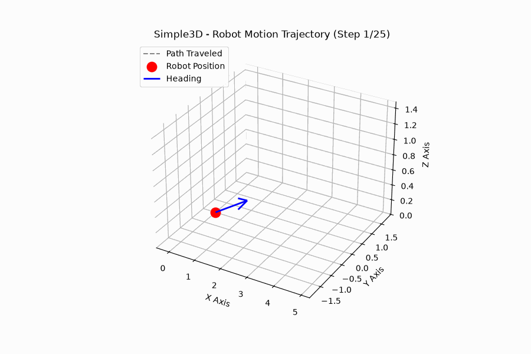

# Simple3D 🚀📐

A lightweight, custom C++ math library built from scratch to handle 3D spatial positioning and orientation, complete with an end-to-end Python 3D motion visualization pipeline.



---

## 🌟 About The Project

When building simulations, game engines, or robotics software, tracking an object requires two core components:

1. **Position:** Where it is in 3D space (x, y, z).
2. **Orientation:** Which way it is facing and tilting (Roll, Pitch, Yaw Euler angles).

Standard C++ does not come with a built-in `Pose` object. **Simple3D** solves this by providing a clean, unified rigid-body `Pose3D` struct that bundles position and orientation together, eliminating the chaos of managing separate variables.

---

## ✨ Features

- **Custom C++ Header Structure:** Lightweight and easy to include in any project.
- **Core Structs:**
  - `Vector3` for 3D coordinates (x, y, z).
  - `EulerAngles` for orientation (Roll, Pitch, Yaw in radians).
  - `Pose3D` combining both with default and parameterized constructors.
- **Operator Overloading:** Built-in `std::ostream` support (`<<`) for clean, readable debugging.
- **Data Export:** Built-in C++ file writing to export static poses or motion trajectories into CSV format.
- **Python 3D Visualizer:** Includes a Python script to render trajectory paths and generate animated GIFs of moving objects in 3D space using `matplotlib`.

---

## 📂 Project Structure

```text
Simple3D/
├── include/
│   └── simple3d/
│       └── pose3d.hpp          # Core C++ Pose library header
├── examples/
│   ├── main.cpp                # Basic test runner
│   └── trajectory.cpp          # Trajectory motion simulator
├── robot_trajectory.gif        # 3D motion visualization animation
└── generate_trajectory_gif.py  # Python animation rendering script
```

---

## ⚙️ Getting Started & Usage

### 1. Prerequisites

Make sure you have a C++ compiler (like `g++` supporting C++17) and Python installed on your system.

### 2. Compile and Run the C++ Code

Compile and run the trajectory generator to create the coordinate data.

**Compile the trajectory generator:**

```bash
g++ -std=c++17 -Iinclude examples/trajectory.cpp -o run_trajectory
```

**Run the executable:**

```bash
./run_trajectory
```

This generates the `trajectory_poses.csv` file containing the trajectory data.

### 3. Visualize the 3D Motion (Python)

Install the required Python visualization packages:

```bash
pip install matplotlib numpy imageio
```

Run the animation script to render the 3D path:

```bash
python generate_trajectory_gif.py
```

---

## 📊 Visualizing the 3D Motion

The Python visualization script (`generate_trajectory_gif.py`) parses the `trajectory_poses.csv` file generated by C++.

It plots each pose along the calculated path step by step, drawing position markers and heading vectors, and renders the result as a smooth animated `robot_trajectory.gif`.

---

## 💡 Built With

- **C++17** — Core math library architecture, data structures, and trajectory simulation engine.
- **Python 3** — 3D spatial plotting and data visualization.
- **Matplotlib** — 3D plotting and visualization.
- **NumPy** — Numerical computing and array operations.
- **ImageIO** — Animated GIF generation.

---

## 👤 Author

**Anupama Balakrishnan**
